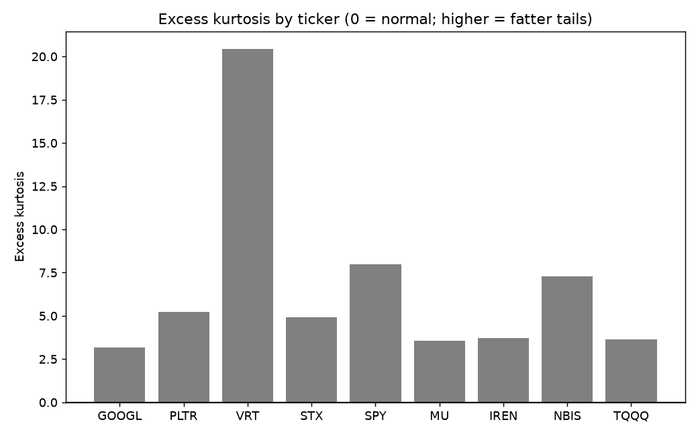

# Distribution Fitting on Real Market Returns

> **Course:** IEMS 302 · **Weeks:** 1 · **Status:** ✅ Complete

## Problem
Black-Scholes, Markowitz, and simple VaR all assume returns are normally
distributed; real returns have fat tails that understate crash risk. This
project quantifies how non-normal my actual holdings really are.

## Approach
- 5y daily log returns for GOOGL, PLTR, VRT, STX, SPY (yfinance).
- Moments with a focus on excess kurtosis (0 = normal) and skewness.
- Fit Normal, Student-t, Laplace by MLE; score with KS, log-likelihood, AIC.
- Histograms with overlaid PDFs + Normal-vs-t QQ-plots.

## Results
Student-t fits every ticker best (lowest AIC and KS); excess kurtosis is
positive everywhere (fat tails); SPY has thinner tails than single stocks.
See `WEEK1_SUMMARY.md` and `results/`.



## How to run
```bash
# from repo root, venv active
pip install yfinance            # one time, if needed
cd projects/01-distribution-fitting
python distribution_fitting.py  # pulls live data, writes results/
# or step through it:
jupyter notebook notebooks/distribution_fitting.ipynb
# verify the pipeline offline (no internet) on synthetic data:
python test_synthetic.py
```

## Files
- `distribution_fitting.py` — the analysis engine (run this)
- `notebooks/distribution_fitting.ipynb` — step-by-step walkthrough
- `test_synthetic.py` — offline correctness check on synthetic fat-tailed data
- `WEEK1_SUMMARY.md` — the one-page writeup
- `results/` — generated plots + results.csv + results_table.md

## What I learned
Fat tails are the rule, not the exception — a Student-t with ~3–5 degrees of
freedom beats the Normal on every holding. KS p-values estimated from the same
data are not strictly valid (Lilliefors), so AIC/KS are used to *rank* fits.
