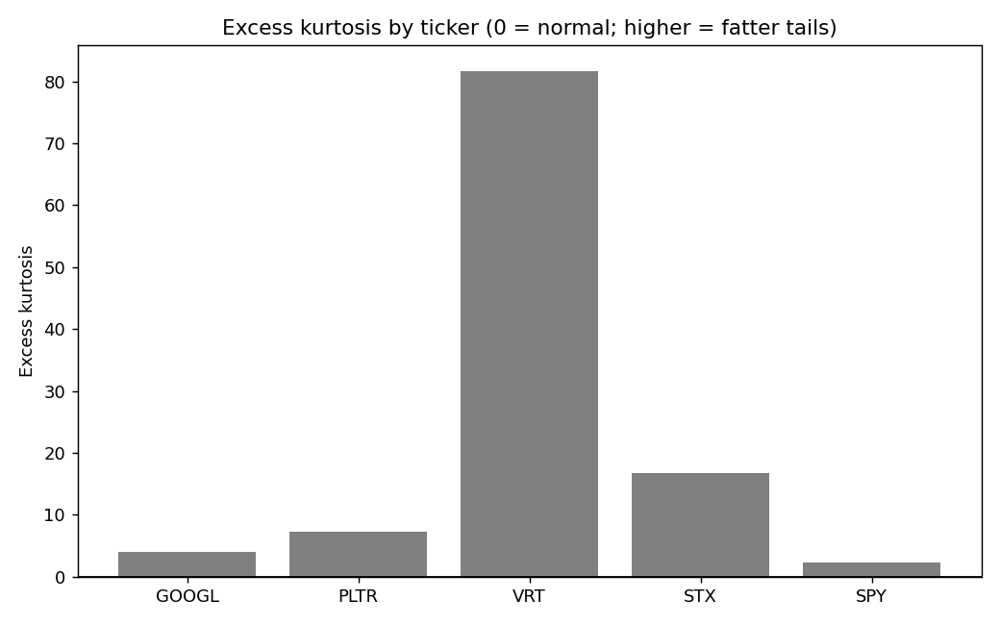
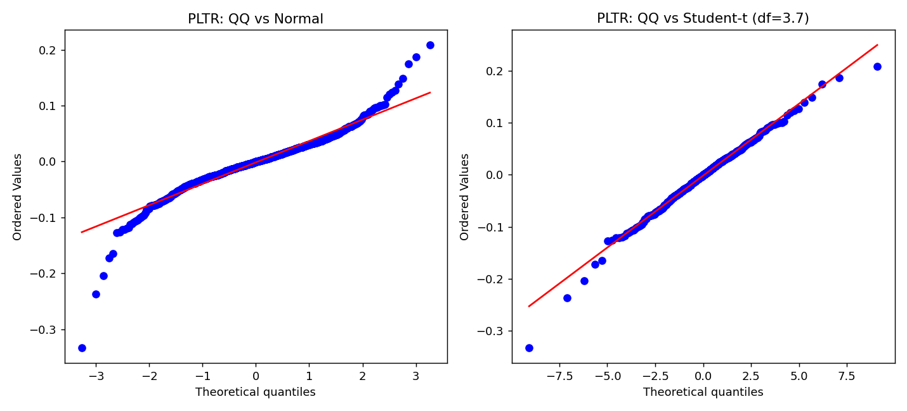

# Week 1 Summary — Distribution Fitting on Real Market Returns
**Course:** IEMS 302 · **Author:** Tteddy · **Holdings analyzed:** GOOGL, PLTR, VRT, STX, SPY, MU, IREN, NBIS, TQQQ (up to 5 years of daily log returns)

> All numbers below are real output from `distribution_fitting.py` on live yfinance data (run August 2026); the full table is auto-generated in `results/results_table.md`. Note NBIS (450 trading days) and IREN (1,184) have shorter listed histories than the 1,253 days of the rest.

## Question
Black-Scholes, Markowitz, and simple VaR all assume daily returns are **normally distributed**. This project tests that assumption directly on real holdings by fitting three distributions — Normal, Student-t, and Laplace — to daily log returns and comparing them with formal goodness-of-fit measures.

## Method
1. Pulled 5 years of split/dividend-adjusted daily prices via `yfinance` and converted to log returns, `r_t = ln(P_t / P_{t-1})`.
2. Measured the first four moments, focusing on **excess kurtosis** (0 for a Normal; positive means fatter tails) and **skewness** (negative means crashes outweigh melt-ups).
3. Fit each distribution by maximum likelihood (`scipy.stats.<dist>.fit`).
4. Scored fits three ways: **KS statistic** (smaller = closer fit), **log-likelihood**, and **AIC** (lower = better, with a penalty for the t's extra parameter so it can't win on flexibility alone).
5. Visual checks: return histograms with all three PDFs overlaid, plus Normal-vs-t QQ-plots.

## Results (live run)

| Ticker | Daily σ | Skew | Excess kurt. | t df | KS (Normal) | KS (t) | Best fit (AIC) |
|:-------|:--------|-----:|-------------:|-----:|------------:|-------:|:---------------|
| GOOGL  | 2.02%   |  0.01 |         3.0 |  4.4 |      0.0502 | 0.0162 | Student-t |
| PLTR   | 4.16%   |  0.55 |         5.8 |  3.6 |      0.0653 | 0.0143 | Student-t |
| VRT    | 4.09%   | −1.49 |        19.1 |  4.4 |      0.0717 | 0.0181 | Student-t |
| STX    | 2.97%   |  0.08 |         4.5 |  3.7 |      0.0610 | 0.0116 | Student-t |
| SPY    | 1.08%   |  0.15 |         7.9 |  3.9 |      0.0724 | 0.0230 | Student-t |
| MU     | 3.53%   |  0.11 |         3.5 |  3.8 |      0.0647 | 0.0232 | Student-t |
| IREN   | 7.30%   |  0.42 |         3.6 |  7.1 |      0.0426 | 0.0248 | Student-t |
| NBIS   | 7.07%   | −0.13 |         6.1 |  5.5 |      0.0438 | 0.0225 | Student-t |
| TQQQ   | 4.30%   | −0.21 |         3.4 |  4.7 |      0.0678 | 0.0252 | Student-t |

The single clearest evidence is the QQ-plot: against a Normal, the points form an **S-curve** that peels away at both ends (real extreme days are more extreme than the bell curve allows); against a Student-t, the same points lie nearly straight.

## What the numbers mean
- **Every ticker has positive excess kurtosis** (3.0 up to VRT's 19.1): fat tails are not an exception, they're the norm. Extreme daily moves happen far more often than a Normal predicts.
- **Student-t wins on AIC for all nine names**, with a KS statistic 1.7–5.3× smaller than the Normal's, even after the t's extra-parameter penalty. The Normal never wins. TQQQ is the closest call: the t beats the Laplace by only about half an AIC point (it went to the Laplace in the June run), so for that name the two fat-tailed fits are effectively tied.
- **Low degrees of freedom (~3.6–4.7 for the long-history names)** confirm heavy tails (the t approaches the Normal only as df → ∞). IREN (7.1) and NBIS (5.5) show higher df, but their shorter histories give less data on rare extremes.
- **Even SPY — the diversified index — has heavy tails** (excess kurtosis 7.9, second only to VRT, and t df 3.9, over a window that includes the 2022 bear market and 2025 drawdowns). Diversification slashes day-to-day volatility (σ 1.08% vs 2–7% for single names) but does not normalize the tail shape.
- **Skew is name-specific in this sample**: most tickers sit near zero or slightly positive, while VRT's −1.49 shows how a few violent down days can dominate the third moment.

## Caveat (honest limitation)
Because each distribution's parameters were estimated from the same data used to test it, the KS **p-values are not strictly valid** (the Lilliefors problem). This doesn't affect the conclusion: KS and AIC are used here to **rank** the three distributions against each other, and that ranking is robust.

## So what? (why this grounds the rest of the summer)
Any model built on the Normal assumption will **understate tail risk** for these holdings — Black-Scholes will misprice deep out-of-the-money options, Markowitz will treat standard deviation as if it captures all risk, and a Normal-based VaR will report a rosier worst case than reality (the exact failure that bit risk managers in 2008). Later projects still *use* the Normal where it buys tractability (Week 3's GBM pricer), but now with eyes open about where and why it lies — and Week 11's optimizer will carry this caveat explicitly.
