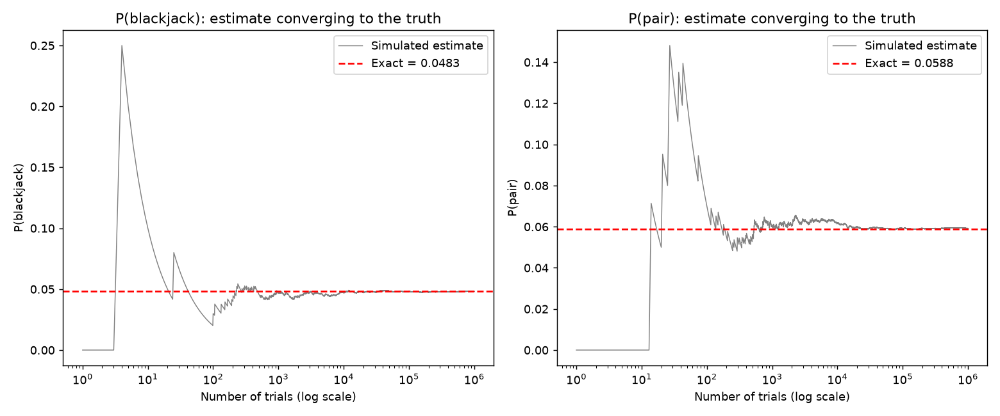

# Blackjack Probability Engine

> **Course:** IEMS 302 · **Weeks:** 2 · **Status:** ✅ Complete

## Problem
Probability intuition is unreliable, and simulation is only trustworthy if
validated. This project computes exact combinatorial answers and checks them
against Monte Carlo estimates, demonstrating convergence (Law of Large Numbers).

## Approach
- Combinatorics (`math.comb`) for P(blackjack) and P(pair).
- Conditional-probability recursion for P(dealer busts | upcard), S17 model.
- Vectorised Monte Carlo: 1,000,000 two-card hands + 300,000 dealer hands/upcard.
- Bonus: EV of standing vs hitting (decision under uncertainty).

## Results
Exact and simulated values agree to ~0.001 across the board. Dealer busts most
on a 6 (~42%), least on an Ace (~12%). EV-based hit/stand decisions reproduce
real basic strategy. See `WEEK2_SUMMARY.md` and `results/`.



## How to run
```bash
cd projects/02-blackjack-probability
python blackjack.py                              # runs everything, writes results/
jupyter notebook notebooks/blackjack_probability.ipynb   # step-by-step + derivations
```

## Files
- `blackjack.py` — analytical formulas, dealer recursion, simulator, EV analysis
- `notebooks/blackjack_probability.ipynb` — walkthrough with LaTeX derivations
- `WEEK2_SUMMARY.md` — one-page writeup
- `results/` — convergence.png, dealer_bust.png, results_table.md

## What I learned
Analytical and empirical methods validate each other; the LLN is visible in a
convergence plot; and the infinite-deck assumption for the dealer recursion is a
deliberate modeling choice (finite-deck would differ slightly via depletion).
