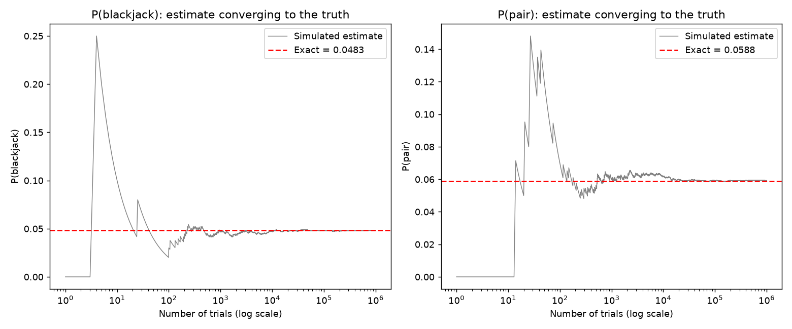
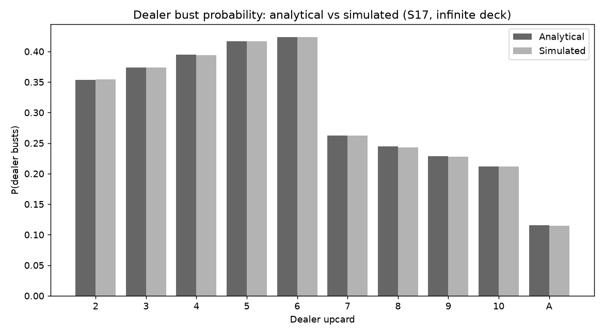

# Week 2 Summary — Blackjack Probability Engine
**Course:** IEMS 302 · **Author:** Tteddy

> All numbers below are real output from `blackjack.py` (analytical values are exact; simulated values use 1,000,000 two-card hands and 300,000 dealer hands per upcard).

## Question
Can I get the *same* probability two independent ways — by exact counting and by simulation — and watch them agree? If yes, I can trust simulation later (Week 3) when exact math is impossible.

## Method
1. **Combinatorics** for first-two-card events, using `math.comb` on a finite 52-card deck.
2. **Conditional-probability recursion** for P(dealer busts | upcard), via the Law of Total Probability over the dealer's next card (infinite-deck, stand-on-17 model).
3. **Monte Carlo simulation** of the same events, with running-estimate convergence plots.
4. **Bonus — decision analysis:** expected value of standing vs hitting, a first taste of Weeks 9–10.

## Results

| Quantity | Exact | Simulated | Match |
|:--|--:|--:|:--:|
| P(blackjack) = 64/1326 | 0.0483 | 0.0481 | ✓ |
| P(pair) = 78/1326 | 0.0588 | 0.0592 | ✓ |
| P(dealer bust \| 6) | 0.4232 | 0.4233 | ✓ |
| P(dealer bust \| 10) | 0.2121 | 0.2119 | ✓ |
| P(dealer bust \| A) | 0.1153 | 0.1151 | ✓ |

Full per-upcard table in `results/results_table.md`. Every analytical and simulated pair agrees to ~0.001.

The convergence plot is the heart of the week: with a handful of trials the estimate swings between 0% and 25%; by ~10,000 trials it sits tight on the exact line. That settling-down **is** the Law of Large Numbers, seen directly.

The dealer busts most often showing a **6** (~42%) and least often showing an **Ace** (~12%) — the asymmetry that underpins basic strategy.

## Decision analysis (bonus)
Comparing EV of standing vs taking one card (win = +1, lose = −1):

| Situation | EV stand | EV hit | Best |
|:--|--:|--:|:--:|
| Player 16 vs dealer 10 | −0.576 | −0.569 | HIT |
| Player 13 vs dealer 6 | −0.154 | −0.236 | STAND |
| Player 15 vs dealer 7 | −0.475 | −0.374 | HIT |

These reproduce real blackjack basic strategy from first principles: hit a stiff 16 against a strong 10, but stand on 13 against a weak 6 and let the dealer bust. The right move flips with the dealer's upcard — a direct consequence of the conditional probabilities above.

## What I learned
- A probability can be attacked analytically *or* empirically, and when both agree you've validated each. This is the core habit the rest of the summer depends on.
- The Law of Large Numbers isn't abstract — you can watch an estimate converge.
- **Modeling caveats matter:** the dealer-bust analysis uses an infinite-deck assumption (independent draws). A finite single deck would differ slightly because of depletion; the first-two-card probabilities, by contrast, are exact finite-deck combinatorics. Being explicit about which assumption applies where is part of getting the right answer.

## So what? (bridge to Week 3)
Week 3's Monte Carlo option pricer has no by-hand check available. Week 2 proved, on problems that *do* have exact answers, that a well-built simulation lands on the truth and that ~10⁴–10⁶ trials is enough to trust it. That license to trust simulation is exactly what Week 3 cashes in.
