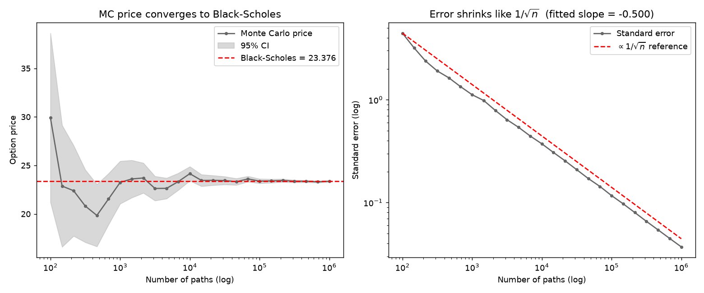

# Monte Carlo Option Pricer

> **Course:** IEMS 302 · **Weeks:** 3 (extended in 4) · **Status:** ✅ Complete

## Problem
Most derivatives have no closed-form price. This engine prices options by
simulating GBM price paths, validated against Black-Scholes where a formula
exists, so it can later price options where none does.

## Approach
- Vectorised GBM terminal-price simulation (500k+ paths per call).
- Monte Carlo European call/put with standard errors + 95% CIs (CLT).
- Black-Scholes closed form as ground truth.
- Convergence study confirming O(1/sqrt(n)) error (fitted slope -0.500).
- Historical vol (from Week 1 returns) vs implied vol (root-find on a market price).

## Results
MC matches Black-Scholes inside the 95% CI for all 12 strike/maturity/option
cases; error scales as 1/sqrt(n). See `WEEK3_SUMMARY.md` and `results/`.



## How to run
```bash
cd projects/03-monte-carlo-pricer
python pricer.py                                   # offline demo, writes results/
jupyter notebook notebooks/monte_carlo_pricer.ipynb
# live data: in Python -> S0, sigma = pricer.load_spot_and_vol("GOOGL")
```

## Files
- `pricer.py` — GBM sim, MC pricing + CIs, Black-Scholes, convergence, vol tools
- `notebooks/monte_carlo_pricer.ipynb` — step-by-step walkthrough
- `WEEK3_SUMMARY.md` — one-page writeup
- `results/` — sample_paths.png, terminal_distribution.png, convergence.png, results_table.md

## What I learned
"Validated" means the true value sits inside the confidence interval, not just
"looks close". 1/sqrt(n) convergence is both a guarantee and a cost. GBM's
normal-returns assumption under-prices fat-tail (deep OTM) options — the
volatility smile's job.
