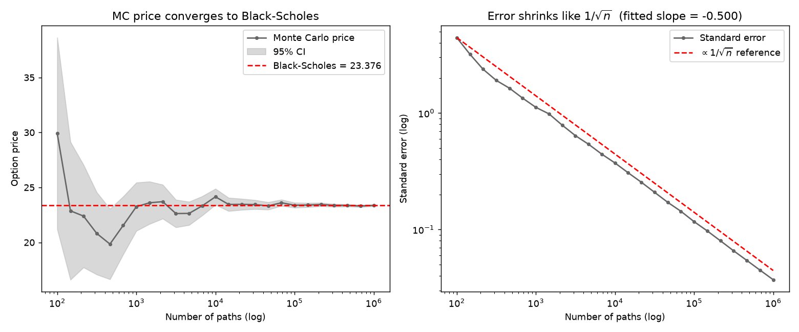
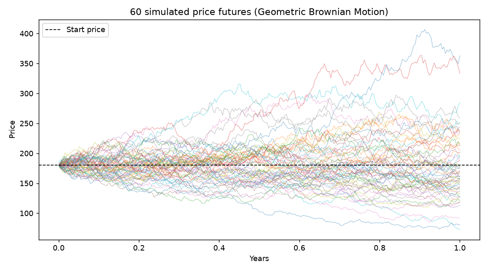

# Week 3 Summary — Monte Carlo Option Pricer
**Course:** IEMS 302 · **Author:** Tteddy

> The MC-vs-Black-Scholes validation runs fully offline, so these numbers are real. Spot price and volatility are illustrative (S0 = 180, σ = 28%) until you run `load_spot_and_vol("GOOGL")` on live data — at which point σ is exactly your Week 1 historical-volatility estimate.

## Question
What is a European option — a payoff of `max(S_T − K, 0)` at expiry — worth today? Price it by simulating thousands of possible futures and averaging the payoff, then prove the answer is right against the exact Black-Scholes formula.

## Method
1. **Simulate futures** with Geometric Brownian Motion: `S_T = S0·exp[(r − σ²/2)T + σ√T·Z]`, `Z ~ N(0,1)`, fully vectorized (500k paths in one call).
2. **Monte Carlo price** = discounted mean payoff, with a standard error and 95% confidence interval from the Central Limit Theorem.
3. **Black-Scholes** closed form as ground truth.
4. **Convergence study**: confirm the error shrinks like 1/√n.
5. **Volatility**: historical (from Week 1 returns) vs implied (inverted from a market price).

## Results — Monte Carlo matches Black-Scholes everywhere

| Option | K | T | Black-Scholes | MC price | 95% CI | BS in CI? |
|:--|--:|--:|--:|--:|:--|:--:|
| call | 160 | 0.25 | 23.9078 | 23.9137 | [23.85, 23.98] | ✓ |
| call | 180 | 1.00 | 23.3761 | 23.3549 | [23.25, 23.46] | ✓ |
| call | 200 | 0.25 | 3.8931 | 3.9127 | [3.88, 3.94] | ✓ |
| put | 180 | 0.25 | 9.1251 | 9.1132 | [9.08, 9.15] | ✓ |
| put | 200 | 1.00 | 27.3550 | 27.3788 | [27.30, 27.46] | ✓ |

Across all 12 strike/maturity/option combinations, Black-Scholes lands inside the Monte Carlo 95% confidence interval. Full table in `results/results_table.md`.

The left panel shows the MC price with its confidence band narrowing onto the Black-Scholes line as paths grow. The right panel is the key theoretical result: on a log-log scale the standard error runs parallel to a 1/√n reference, with a **fitted slope of −0.500** — an exact confirmation of the Central Limit Theorem rate. The practical lesson: to halve the error you need *four times* the paths.

Each line is one simulated future. Pricing the option means averaging the payoff across all of them — the Week 2 simulation trick, now applied to stock prices.

## Volatility (the one input you can't read off a screen)
- **Historical vol** comes straight from Week 1's daily returns: σ_annual = std(returns)·√252.
- **Implied vol** is the σ that makes Black-Scholes match a real market price; the engine recovers it by root-finding (recovered 0.320 from a price built at 32%, exactly).
- When implied > historical, the market expects more future turbulence than the past delivered — common around earnings.

## What I learned
- Monte Carlo and a closed-form formula agreeing inside a confidence interval is what "validated" actually means — not eyeballing, but the true value sitting in the stated range.
- 1/√n convergence is both a guarantee (it always works eventually) and a warning (accuracy is expensive), which is why Week 4 will add variance-reduction tricks.
- The CLT gives the error bars for free, turning a point estimate into an honest range.

## So what? (bridge to Week 4)
Black-Scholes only exists for the simplest options. Week 4 prices **path-dependent** options (Asian, whose payoff depends on the whole trajectory) that have *no* closed-form answer — so the only check is the validation done here. Having proven MC matches BS where a formula exists, we can trust MC where none does.

**Honest caveat carried forward:** GBM assumes normal returns, so it under-prices the deep out-of-the-money options that only pay off in the fat-tailed crashes Week 1 measured. That mismatch is much of what the real-world "volatility smile" corrects for — and a reminder to use the tool knowing exactly where it bends the truth.
