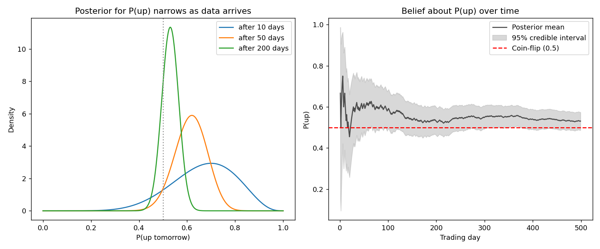

# Options Extensions + Bayesian Mini-Project

> **Course:** IEMS 302 · **Weeks:** 4 · **Status:** ✅ Complete

## Problem
Week 3's terminal-value shortcut breaks for path-dependent options, naive MC is
expensive, and traders need sensitivities. This project extends the validated
Week 3 pricer to handle all three, plus a Bayesian estimate that learns from data.

## Approach
- **Imports** the Week 3 `pricer.py` (no duplication) and builds on it.
- Asian (arithmetic-average) options via full paths — no closed-form price.
- Antithetic variates for variance reduction, re-validated against Black-Scholes.
- Delta & Vega by finite differences with common random numbers, vs analytical.
- Beta-Binomial Bayesian updater for P(up tomorrow), posterior over time.

## Results
Asian < European (13.05 vs 23.29); antithetic gives ~1.66x variance reduction;
finite-diff Greeks match BS to ~3 decimals; Bayesian credible interval narrows
from 0.50 to 0.087. See `WEEK4_SUMMARY.md` and `results/`.



## How to run
```bash
cd projects/04-options-extensions
python options_extensions.py        # imports ../03-monte-carlo-pricer/pricer.py
jupyter notebook notebooks/options_extensions.ipynb
```

## Files
- `options_extensions.py` — Asian, antithetic, Greeks, Bayesian engine
- `notebooks/options_extensions.ipynb` — walkthrough with LaTeX
- `WEEK4_SUMMARY.md` — one-page writeup
- `results/` — antithetic.png, greeks.png, bayes_posterior.png, results_table.md

## What I learned
Reusing validated code makes hard problems tractable; sign checks validate
prices when no formula exists; common random numbers are essential for clean MC
Greeks; variance reduction must be checked for correctness, not just speed.
