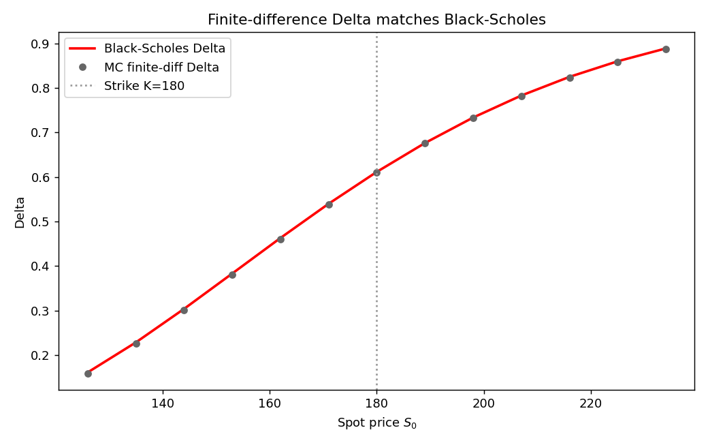
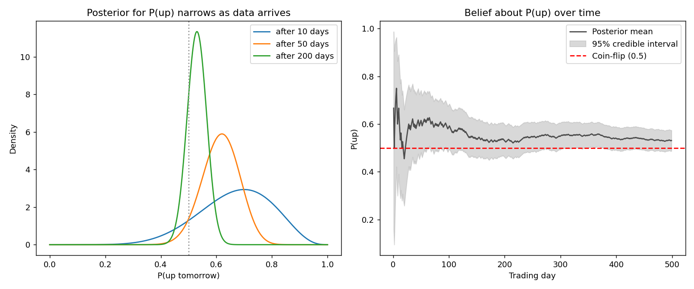

# Week 4 Summary — Options Extensions + Bayesian Mini-Project
**Course:** IEMS 302 · **Author:** Tteddy

> All numbers are real output from `options_extensions.py`, which **imports and reuses** the validated Week 3 pricer (`pricer.py`). Spot and volatility are illustrative (S0 = 180, σ = 28%); the Bayesian part runs on synthetic data offline or live GOOGL data when internet is available.

## Question
Take the validated Week 3 Monte Carlo engine and push it where Black-Scholes can't follow: options with no formula, cheaper estimation, and the sensitivities traders hedge with — plus a Bayesian probability that learns from data.

## Method & Results

### 1. Asian options (no closed-form price)
An arithmetic Asian call pays `max(avg(S) − K, 0)`, averaging the price over the whole path. This needs full trajectories (Week 3's `simulate_paths`) and has no simple Black-Scholes value.

- Asian call = **13.05** (95% CI [12.96, 13.13])
- European call = **23.29**
- Asian < European ✓ — averaging smooths out extremes, lowering effective volatility, so the option is worth less. This sign check is the sanity test that replaces a missing formula.

### 2. Antithetic variates (variance reduction)
For each draw `Z`, also use `−Z`; the mirrored payoffs are negatively correlated, so averaging within pairs cancels noise.

| Paths | SE plain | SE antithetic | Variance reduction |
|--:|--:|--:|--:|
| 10,000 | 0.366 | 0.284 | 1.66× |
| 200,000 | 0.083 | 0.064 | 1.66× |
| 1,000,000 | 0.037 | 0.029 | 1.66× |

A stable ~1.66× variance reduction for the same path count — free accuracy. And correctness survives: Black-Scholes (23.376) still falls inside the antithetic 95% CI.

### 3. Greeks via finite differences
Delta = ∂price/∂S0, Vega = ∂price/∂σ, by central difference with **common random numbers** (same `Z` for both bumps) so the simulation noise cancels.

| Greek | MC | Black-Scholes | abs diff |
|:--|--:|--:|--:|
| Delta | 0.6125 | 0.6114 | 0.0011 |
| Vega | 69.05 | 68.99 | 0.06 |

The MC Delta sits exactly on the analytical curve across all spot prices — common random numbers are what make finite-difference Greeks usable instead of hopelessly noisy.

### 4. Bayesian updater (Beta-Binomial)
P(up tomorrow) with a Beta prior, updated daily by conjugacy: posterior = Beta(α₀ + #up, β₀ + #down).

The posterior starts wide (little data → low confidence) and visibly narrows as days accumulate; on 499 days of live GOOGL data the 95% credible interval shrank from width 0.50 (day 10) to 0.087 (final), around a posterior mean of 0.531. This is Bayes' Rule made into a living estimate — and a direct echo of Week 1's lesson that a point estimate hides how sure you should be.

## What I learned
- Building on validated code (importing `pricer.py`) instead of rewriting is what makes the harder problems tractable — and it's the design that makes the Week 11 capstone possible.
- The sign check (Asian < European) is how you validate a price when no formula exists — you confirm the qualitative properties any correct answer must have.
- Variance reduction is real engineering: same compute, better answer, but only if it doesn't quietly break correctness (so we re-checked against BS).
- **Common random numbers** is the non-obvious trick that turns noisy MC Greeks into clean ones — the noise cancels in the subtraction only if both prices share the same draws.

## So what? (bridge to Phase 2 — CS 217)
Every model in Phase 1 is hungry for the same thing: lots of clean, repeatable, correctly-structured data — many tickers, many days, fed without errors or gaps. That is a *data-engineering* problem, not a probability one. Phase 2 (Weeks 5–8) builds exactly that: a normalized portfolio database, analytical SQL, and an automated ETL pipeline — the plumbing that will feed these pricers and, ultimately, the capstone.
