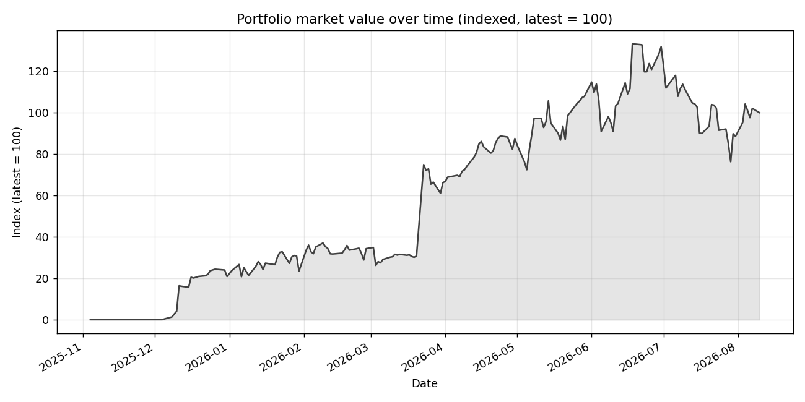
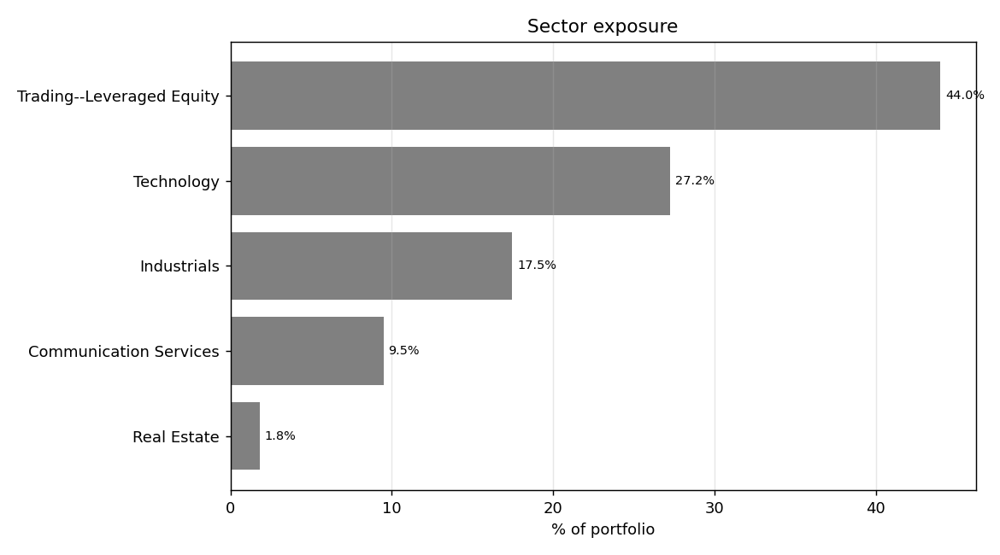

# Week 6 Summary — Portfolio Database: Analytical Queries
**Course:** CS 217 · **Author:** Tteddy

> All numbers below are real output from `dashboard.py` running `sql/queries.sql`
> against the rebuilt portfolio database (555 trades, 67 securities, 31,291
> price rows, 18 dividend rows; prices through 2026-08-10).

## Question
Week 5 turned brokerage exports into a constrained, queryable database. That
made storage trustworthy but answered nothing. This week turns it into an
analytics engine: positions, cost basis, FIFO-matched realized P&L, value over
time, sector exposure, per-holding extremes, and income by quarter — all as SQL
against those four tables, with nothing derived stored anywhere.

## What the data turned out to be hiding

Before a single query could be trusted, the database had to be repaired. Three
defects were found by querying for impossible states rather than by reading code:

| Defect | Evidence | Cause |
|:--|:--|:--|
| 7 duplicated trades | IREN net −100 shares, TQQQ −1.5 | `sample_fidelity.csv` loaded once via `--demo` and again inside the real export |
| 655 fake price rows | `open = close×0.99` exactly, for 5 tickers over 131 days | the demo's synthetic random walk written into the production DB; `INSERT OR IGNORE` then silently *shadowed* the real yfinance prices |
| 2 lost share lots | FXAIX net −0.006 | the loader kept only `YOU BOUGHT`/`YOU SOLD`, dropping `REINVESTMENT` rows, which are genuine share purchases |

The negative positions were the tell. A position cannot be negative in a
long-only cash account, so any query returning one is reporting a fact the world
does not contain. That is the useful thing about deriving positions instead of
storing them: an impossible number is visible immediately rather than sitting in
a column nobody re-checks.

Two schema-level changes make the first two defects structurally impossible to
repeat, rather than relying on remembering not to cause them:

- **`trades.source_ref TEXT UNIQUE`** — a fingerprint of each source CSV row
  (content **plus line number**). Re-running any export now inserts zero rows.
  The line number matters: two identical fills on the same day at the same price
  are real, and hashing content alone would silently merge them.
- **`--demo` writes to its own database file.** Synthetic and observed data
  never share a table again.

## The FIFO problem, and how it is solved in pure SQL

Realized P&L needs each sale matched to the specific shares it disposed of.
FIFO is a sequential rule, which is why it is usually written as a Python loop
over a queue of lots. It can be done in one query instead.

Picture every share of a ticker as occupying a point on a number line: the first
share ever bought sits at position 0, the next at 1, and so on. Then a buy of
`q` shares covers the interval `[bought_before, bought_before + q)`, and a sale
of `q` shares consumes `[sold_before, sold_before + q)`. Under FIFO a sale
always consumes the lowest unsold positions — so **a buy lot and a sale are
matched exactly where their intervals overlap**, and the matched quantity is the
length of that overlap:

```sql
SUM(quantity) OVER (PARTITION BY ticker ORDER BY trade_date, trade_id
                    ROWS BETWEEN UNBOUNDED PRECEDING AND CURRENT ROW)
```

gives each lot its interval; an inequality join with
`MIN(b.lot_end, s.lot_end) - MAX(b.lot_start, s.lot_start) > 0` finds the
overlaps. No cursor, no loop, no Python. The same interval arithmetic answers
the other half of the question: a lot's shares are **still held** when its
interval lies above everything sold so far, which gives the FIFO cost basis for
open positions — so realized and unrealized P&L use one consistent convention
instead of two that quietly disagree.

Fees are apportioned to each match in proportion to the fraction of the lot
consumed, so a partial sale carries a partial fee.

## Results

Values are **indexed to current market value = 100**, the same convention the
capstone site uses. Every ratio and conclusion below is unchanged; only the
scale is withheld.

| Measure | Indexed |
|:--|--:|
| Open positions | 14 |
| Cost basis (FIFO) | 110.6 |
| Market value | 100.0 |
| Unrealized P&L | −10.6 |
| Realized P&L (FIFO, net of fees) | +7.9 |
| Dividend & interest income | +0.2 |
| **Total P&L** | **−2.4** |

Realized trading has been profitable across 57 tickers with closed round trips.
The best four by return on closed cost: NBIS +11.9% (5 round trips), MU +5.9%
(19), UAMY +4.9% (21), ONDS +2.9% (73). The overall loss comes entirely from
open positions.





### What the sector query surfaces

| Sector | Holdings | % of portfolio |
|:--|--:|--:|
| Trading–Leveraged Equity | 7 | 44.0% |
| Technology | 2 | 27.2% |
| Industrials | 2 | 17.5% |
| Communication Services | 2 | 9.5% |
| Real Estate | 1 | 1.8% |

Two facts fall out that no brokerage screen was showing. First, leveraged 2x
ETFs are the single largest exposure at 44.0% across seven positions — a
concentration that is invisible when each one is viewed individually. Second,
those same instruments hold the four largest unrealized losses in the book
(LUNL −61%, ASTX −55%, NVTX −40%, NBIG −37%), which is the volatility-decay
behaviour daily-rebalanced leveraged funds exhibit over multi-week holds.
Meanwhile the single largest gain is MU at +128%.

This is the payoff of owning the data: the question "how much of my money is in
one kind of instrument" is one line of SQL, and nobody else's app was going to
volunteer the answer.

## Transactions & ACID

`transactions.py` demonstrates each property against a scratch database and
prints what actually happened rather than asserting it:

| Property | Demonstrated by | Relied on for |
|:--|:--|:--|
| **Atomicity** | booking a trade as three writes where the third violates `CHECK(close > 0)` | recording a trade is *several* writes — security, execution, price — and a partial write leaves a trade referencing a security that does not exist |
| **Consistency** | five invalid writes, all refused (FK, two CHECKs, composite PK, UNIQUE `source_ref`) | the engine rejects bad data on every path in, not just the careful ones |
| **Isolation** | a second connection reading during an open transaction | the dashboard may query mid-booking; it must see before or after, never halfway |
| **Durability** | commit, drop the connection, reopen | a booked trade is a financial record |

A fifth scenario covers the invariant that *cannot* be a column constraint:
"don't sell more shares than you hold" depends on other rows, so it is checked
inside the transaction and rolled back like any other violation.

## Testing

`test_queries.py` runs 49 checks in two layers.

**Hand-computed cases** on tiny synthetic databases, because real data can only
show that nothing looks obviously wrong. The load-bearing one: buy 10 @ \$10,
buy 10 @ \$20, sell 15 @ \$30. FIFO gives \$250, LIFO would give \$200, and
average cost \$225 — so the test pins down the matching order rather than merely
checking the arithmetic runs. Others cover partial sales, pro-rata fees,
fractional shares, sell-everything-then-rebuy, duplicate same-day fills, and a
fully-closed position that must not reappear as float dust.

**Invariants on the real portfolio**, which catch what small cases cannot:
shares closed never exceed shares bought; every sold share matches a buy lot;
`bought = closed + held` per ticker; per-match and per-ticker realized P&L agree
to within a cent; sector weights sum to 100%; the market value in `cost_basis`
reconciles with the last point of `portfolio_value` to 0.00%.

All 49 pass, along with 5/5 ACID demonstrations.

Testing found two genuine bugs, both in code written this week: the ACID
consistency demo ran its duplicate-price check against an empty `prices` table,
so it inserted nothing and reported a missing constraint that was actually
present; and the rewritten parser assumed every export has an `Action` column,
which broke `--demo` on the trimmed CSV layout.

## Honest limitations
- **Accounts are collapsed.** The export spans four brokerage accounts, and the
  schema has no account entity, so positions and dividends are portfolio-wide.
  Per-account P&L is not answerable until accounts are modelled.
- **Cash is not tracked.** SPAXX (the sweep fund) is excluded from `trades`,
  because its "shares" are dollars and it has no sell rows. Its income still
  counts, but portfolio value is securities-only and excludes uninvested cash.
- **One ticker has no prices.** `44984F807` is a CUSIP Fidelity emitted for INVO
  Fertility after a reverse split. It nets to zero shares so it never reaches a
  valuation query, but it would need remapping if it were still held.
- **Sector data is third-party.** 57 of 62 securities resolve; funds carry a
  category rather than a true sector, and yfinance labels a few oddly (SPYM
  comes back as a stock).

## So what?
Week 7 automates the feed with a validated, idempotent, logged ETL job — and the
`source_ref` mechanism built here is exactly the idempotency guarantee that week
asks for, arrived at the hard way. Week 11's optimizer draws its returns from
these tables rather than fresh yfinance calls, which is only safe because the
repairs above mean the stored prices are now the real ones.
