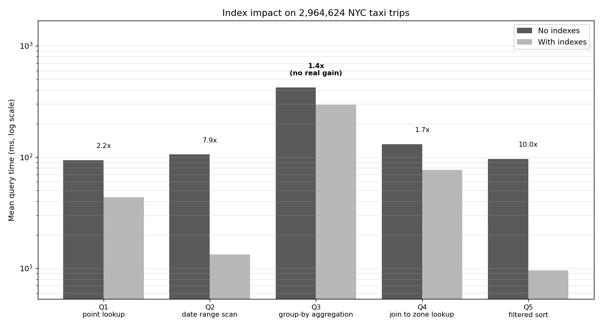

# Query Optimization Study

> **Course:** CS 217 · **Week:** 8 · **Status:** ✅ Complete

## Problem
Queries that feel instant on 1,000 rows take minutes on 3 million. Indexing is
usually the difference — but indexes cost space and write throughput, and
sometimes buy nothing. This replaces "add an index and hope" with measurement.

## Approach
- 2.96M NYC Yellow Taxi trips (TLC, Jan 2024) loaded into SQLite in 8.3s.
- Five query shapes spanning "an index is transformative" to "irrelevant".
- Each timed with and without indexes, `EXPLAIN QUERY PLAN` recorded both times.
- Separate experiments for composite column order and for write cost.

## Results


| Query | Before | After | Speed-up | Plan after |
|:--|--:|--:|--:|:--|
| Q1 point lookup | 93.7 ms | 43.5 ms | 2.2x | INDEX SEEK |
| Q2 date range | 105.5 ms | 13.3 ms | 7.9x | INDEX SEEK |
| Q3 group-by | 422.1 ms | 295.8 ms | 1.4x | INDEX **SCAN** |
| Q4 join | 130.9 ms | 76.7 ms | 1.7x | INDEX SEEK |
| Q5 filtered sort | 96.5 ms | 9.6 ms | 10.0x | INDEX SEEK |

**Q3 is the one that didn't benefit.** Its plan still says SCAN, not SEARCH: with
~5 distinct `payment_type` values across 3M rows there is nothing to narrow, so
the index only removed a sort. Cost side: +235 MB (88% larger) and **3.77x
slower inserts**.

**Composite column order** costs 1.9–2.2x when wrong, but fails two different
ways — a low-cardinality leading column gets rescued by SQLite's skip-scan, a
high-cardinality one makes the planner abandon the index entirely.

## How to run
```bash
python projects/08-query-optimization/load_taxi.py     # downloads ~48 MB, loads 2.96M rows
python projects/08-query-optimization/benchmark.py     # full study + charts
python projects/08-query-optimization/test_benchmark.py  # 32 checks
```

## What I learned
The useful question is not "did it use an index?" but "does the plan say SEARCH
or SCAN?" — a full index scan reads every row and can still look like a win. The
sharpest finding came from a failing test: two queries had ties with no
tie-breaker, so adding an index **changed which rows the report returned**. A
query whose output depends on the access path is a latent bug that surfaces the
day someone indexes the table for unrelated reasons.
