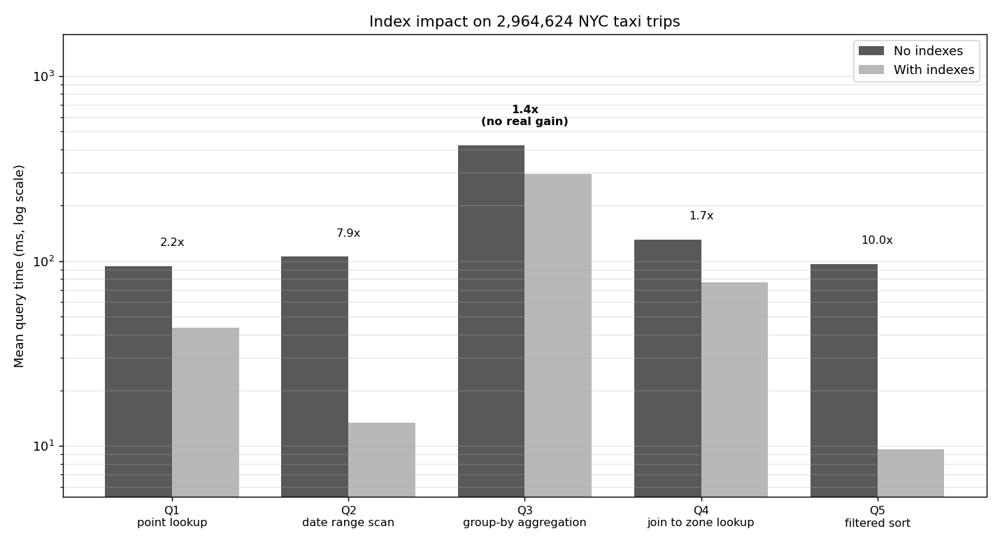

# Week 8 Summary — Query Optimization Study
**Course:** CS 217 · **Author:** Tteddy

> All numbers are real output from `benchmark.py` against 2,964,624 NYC Yellow
> Taxi trips (TLC, January 2024), mean of 5 timed runs after a warm-up run.

## Question
A query that feels instant on a thousand rows can take minutes on three million.
Indexing is usually the difference — but indexes are not free, and they do not
always help. This week replaces "add an index and hope" with measurement.

## Setup
2.96M trips loaded from Parquet into SQLite in 8.3s (268 MB, no indexes), plus a
265-row `zones` lookup table. Five query shapes, each timed with no indexes and
again with four indexes, recording `EXPLAIN QUERY PLAN` both times.

## Results

| Query | Before | Plan | After | Plan | Speed-up |
|:--|--:|:--|--:|:--|--:|
| Q1 point lookup (one zone) | 93.7 ms | FULL SCAN | 43.5 ms | INDEX SEEK | **2.2x** |
| Q2 date range (one day of 31) | 105.5 ms | FULL SCAN | 13.3 ms | INDEX SEEK | **7.9x** |
| Q3 group-by aggregation | 422.1 ms | FULL SCAN | 295.8 ms | INDEX **SCAN** | **1.4x** |
| Q4 join to zone lookup | 130.9 ms | FULL SCAN | 76.7 ms | INDEX SEEK | **1.7x** |
| Q5 filtered sort | 96.5 ms | FULL SCAN | 9.6 ms | INDEX SEEK | **10.0x** |



## The query where the index did not help — and why

**Q3** (`GROUP BY payment_type`) gained 1.4x, against 10x for Q5. The plan says
exactly why, and the distinction is the whole lesson:

```
before:  SCAN trips | USE TEMP B-TREE FOR GROUP BY
after:   SCAN trips USING INDEX idx_trips_payment
```

Both plans say **SCAN**, not SEARCH. The index did not eliminate a single row —
every one of the 2.96M trips contributes to a group, so there is nothing to
narrow. What it removed was the *sort*: because the index is already ordered by
`payment_type`, SQLite could drop the temporary B-tree it was building to group
the rows. The remaining 1.4x is that saved sort plus reading a narrower
structure, not selectivity.

That is why `payment_type` was a bad index candidate from the start: **~5 distinct
values across 3M rows.** An index earns its keep by letting you skip work, and a
predicate matching a fifth of the table lets you skip nothing. Q1 by contrast
matches 2.6% of rows, so the seek pays.

The general rule the measurement supports: an index helps in proportion to how
much of the table it lets you *not* look at. When the answer needs every row, the
best an index can do is change how you read them.

## What the plans actually distinguish

Classifying "did it use an index?" is the wrong question, and my first version of
this benchmark got it wrong in two ways worth recording:

1. **SEARCH vs SCAN.** `SEARCH … USING INDEX` is a seek — descend the B-tree, touch
   only matching rows. `SCAN … USING INDEX` still visits everything, just via the
   index. Collapsing both to "indexed" is precisely how you convince yourself Q3
   was helped.
2. **The driving loop.** A join plan concatenates several steps, and the inner ones
   are almost always indexed. Q4's unindexed plan is `SCAN t | SEARCH z USING
   INTEGER PRIMARY KEY` — reading the whole string makes a full table scan look
   indexed, on the strength of a 265-row lookup.

## Composite index column order

A composite index on `(a, b)` is a B-tree sorted by `a`, then by `b` within equal
`a`. It serves a lookup on `a` alone; a lookup on `b` alone has no contiguous run
to seek to. Measured both ways:

| Filter column | Index order | Time | Plan |
|:--|:--|--:|:--|
| `pu_location_id` (260 distinct) | `(pu_location_id, pickup_ts)` ✓ | 51.1 ms | INDEX SEEK |
| `pu_location_id` | `(pickup_ts, pu_location_id)` ✗ | 94.9 ms | **FULL SCAN** |
| `pickup_ts` (1.58M distinct) | `(pickup_ts, pu_location_id)` ✓ | 13.8 ms | INDEX SEEK |
| `pickup_ts` | `(pu_location_id, pickup_ts)` ✗ | 30.5 ms | **INDEX SKIP-SCAN** |

Getting the order wrong costs 1.9x in the first case and 2.2x in the second — but
the two failures are not the same failure, and the plans say so.

In the second case SQLite falls back to a **skip-scan**: the plan reads
`ANY(pu_location_id) AND pickup_ts>?`, meaning it loops over each of the 260
distinct leading values and seeks within each one. That is viable precisely
because there are only 260. In the first case the wrong leading column is
`pickup_ts` with 1.58 million distinct values — 1.58M seeks would cost more than
reading the table, so the planner correctly abandons the index entirely.

So the textbook rule ("the leading column must match") is right, with a caveat
worth knowing: **a low-cardinality leading column is partially forgiving, a
high-cardinality one is not.** That asymmetry is invisible without looking at the
plans.

## The cost side

Indexes are paid for in space and in write throughput.

- **Space:** the database grew from **268 MB to 503 MB** — +235 MB, an 88%
  increase, for four indexes on one table.
- **Writes:** 20,000 inserts took 9.5 ms with no indexes and 35.8 ms with four —
  **3.77x slower**, because every insert must also splice a new entry into four
  separate B-trees.
- **Build time:** 2.6s total for the four indexes on 3M rows.

For an append-heavy ingest path (the Week 7 ETL, say), that 3.77x is the number
that matters and argues for indexing only what is queried. For a read-heavy
analytics table it is obviously worth paying.

## How B-tree indexes work (the mental model this supports)

An index is a separate, sorted copy of one or more columns plus a pointer back to
the row. Sorted order is what makes a seek possible: at each node the engine
compares and discards a whole subtree, so finding a value among 3M rows takes
about log₂(3M) ≈ 21 comparisons instead of 3M. That is the 10x on Q5.

Three consequences fall straight out, and all three showed up in the measurements:
range scans are cheap because sorted neighbours are adjacent (Q2, 7.9x); the
sort order is free to reuse for `ORDER BY`/`GROUP BY` (Q3's saved B-tree); and
every write must maintain every tree (the 3.77x).

## A bug the tests caught: indexes changing answers

The test asserting that every query returns identical results with and without
indexes **failed** on Q3 and Q5. The cause was not the indexes — it was that both
queries had a non-deterministic `ORDER BY`:

```sql
ORDER BY trips DESC          -- ties between equal counts broken arbitrarily
ORDER BY fare_amount DESC LIMIT 20   -- worse: LIMIT over ties picks an arbitrary subset
```

With ties present, the output order depends on the order rows arrive in, which is
decided by the access path — so **adding an index silently changed which rows the
report showed.** On the real data the counts happened to differ and it looked
stable; the synthetic test data made the ties explicit.

Fixed by making every sort total (`ORDER BY trips DESC, payment_type`,
`ORDER BY fare_amount DESC, trip_id`). The lesson generalises well beyond
benchmarking: a query whose result depends on the plan is a latent bug, and it
surfaces the day someone adds an index for unrelated reasons.

## Testing
`test_benchmark.py` runs **32 checks**: plan classification (seek vs scan vs
skip-scan vs covering, and picking the driving loop out of a join), the
answers-unchanged invariant on every query, index-changes-the-plan in the
expected direction, selectivity sanity (a "point lookup" that matched half the
table would not be testing what it claims), timing-helper behaviour, and a final
pass against the real 2.9M-row database.

Two reporting bugs were found this way beyond the `ORDER BY` issue: the join
classifier described above, and a database-size delta that came out **negative**
because `DROP INDEX` releases pages to SQLite's free list without shrinking the
file — the "before" size still contained the previous run's index pages until a
`VACUUM`.

## So what?
Week 6's portfolio queries run against tables of thousands of rows, where all of
this is invisible. The habit that transfers is the one this week forces: read the
plan, check whether it says SEARCH or SCAN, and measure rather than assume. The
`idx_trips_*` set here is also why the Week 5 schema carries
`idx_trades_ticker_date` — the same ticker-then-date leading-column reasoning,
now with numbers behind it.
