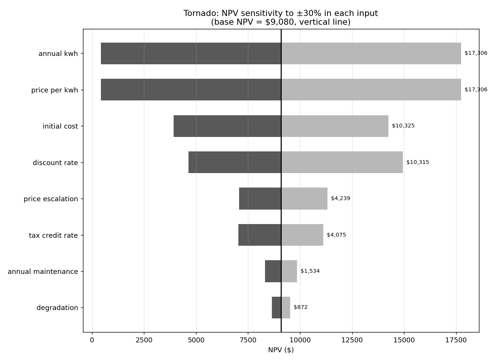

# Capital Budgeting & Sensitivity Tool

> **Course:** CivEnv 205 · **Week:** 9 · **Status:** ✅ Complete

## Problem
Every capital decision compares cash flows arriving at different times. NPV and
IRR do that — but a single NPV is overconfident, because it hides the fact that
the answer rests on assumptions somebody guessed. Sensitivity analysis finds
which guess the decision actually depends on.

## Approach
- Core measures: NPV, IRR, discounted payback (interpolated), profitability index.
- IRR done safely: every root found by scanning for NPV sign changes, so
  non-conventional cash flows get a warning instead of an arbitrary answer.
- Incremental analysis for mutually exclusive projects of different scale.
- A driver-based project model, so sensitivity varies *assumptions* not numbers.
- Tornado (±30% one-at-a-time), break-even solving, and probability-weighted
  scenario analysis.

## Results


11 kW rooftop solar: **NPV $9,080**, IRR 10.35%, discounted payback 13.6 years,
PI 1.378 — accept.

- **Production and price dominate** (±$17,306 swing each); maintenance and
  degradation are noise (±$1,534 and ±$872).
- **Break-even:** production can miss by **31.5%** before the project loses money.
- **Scenarios:** E[NPV] $9,183, SD $9,592, **P(NPV < 0) = 25%** — the spread
  exceeds the mean, which the point estimate completely hides.
- **IRR vs NPV conflict:** a smaller, more efficient array has the higher IRR
  (10.76% vs 10.35%) but far lower NPV. Incremental analysis picks the large
  system, because the extra outlay returns 10.21% against a 6% hurdle.

## How to run
```bash
python projects/09-capital-budgeting/capital_budgeting.py       # worked case study
python projects/09-capital-budgeting/test_capital_budgeting.py  # 68 checks
```

## What I learned
IRR is the measure everyone quotes and the one that breaks most easily. It is
ambiguous when cash flows change sign more than once — `[-4000, 25000, -25000]`
genuinely has two IRRs, 25% and 400% — and it systematically misranks mutually
exclusive projects because a rate ignores scale. Both failures are invisible
unless you look for them, which is why the module detects sign changes and
reports every root rather than returning one.
