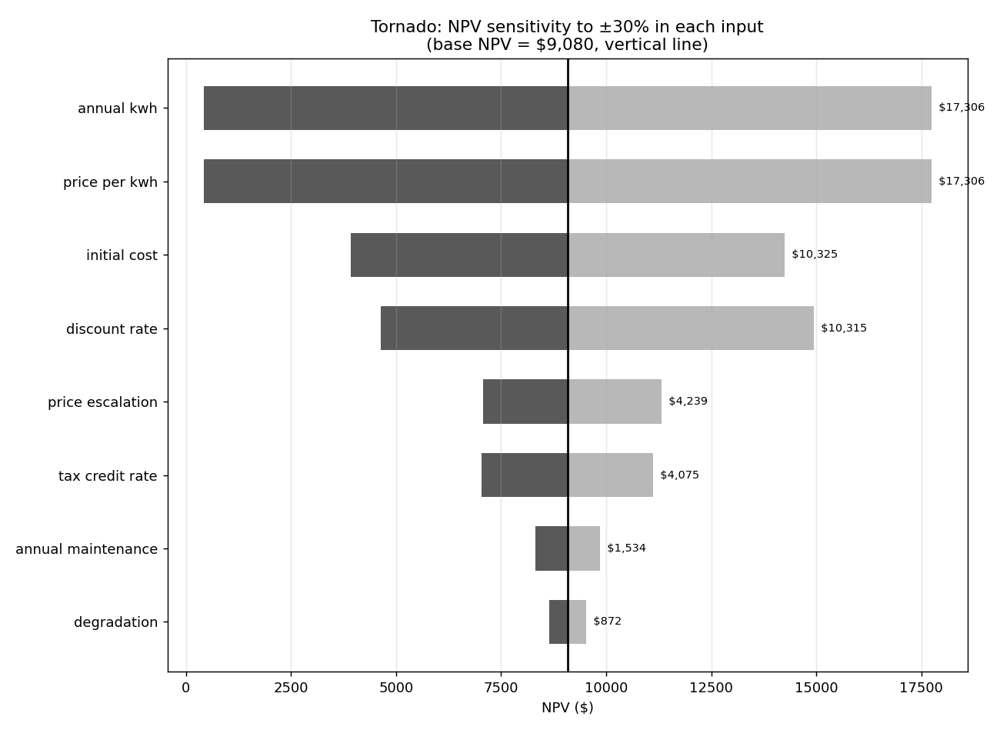
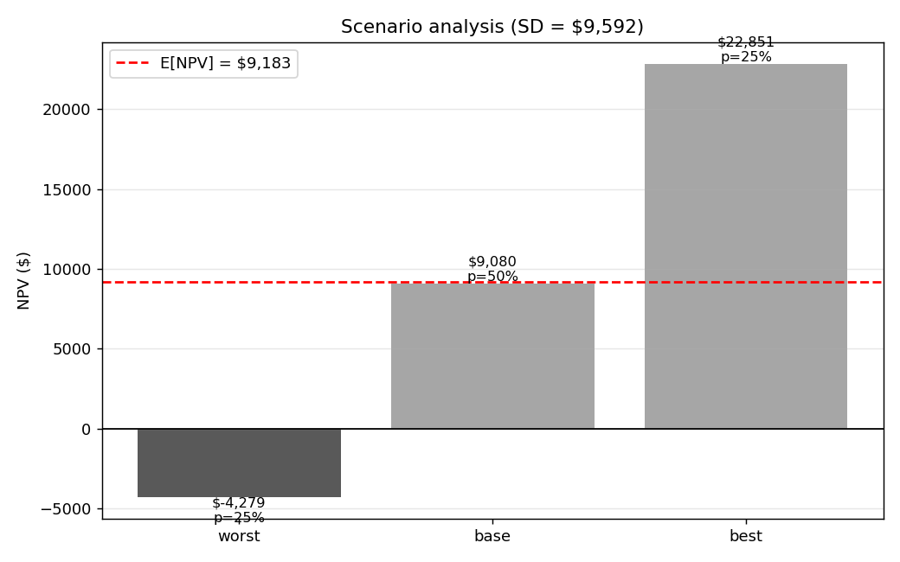

# Week 9 Summary — Capital Budgeting & Sensitivity Analysis
**Course:** CivEnv 205 · **Author:** Tteddy

> All numbers are real output from `capital_budgeting.py`. The case study is an
> 11 kW rooftop solar installation, modelled from its drivers rather than from a
> fixed cash-flow list, so sensitivity analysis has real assumptions to vary.

## Question
Every capital decision compares cash flows arriving at different times, and a
dollar in 2051 is not a dollar today. NPV and IRR handle that. But a single NPV
is dangerously overconfident: it hides that the answer rests on numbers somebody
guessed. Which guess does the decision actually depend on, and how wrong does it
have to be before the answer flips?

## The project

| Assumption | Value |
|:--|--:|
| Installed cost | $24,000 |
| Federal tax credit | 30% ($7,200, received in year 1) |
| First-year production | 11,000 kWh |
| Avoided utility rate | $0.170/kWh, escalating 2.5%/yr |
| Panel degradation | 0.5%/yr |
| Maintenance | $200/yr |
| Life / discount rate | 25 years @ 6% |

## Core results

| Measure | Value |
|:--|--:|
| **NPV** | **$9,079.71** |
| IRR | 10.35% |
| Discounted payback | 13.61 years |
| Profitability index | 1.378 |
| Sign changes | 1 (so the IRR is unique) |

**Decision: accept.** The project returns 10.35% against a 6% opportunity cost,
and creates $1.38 of present value per dollar invested.

Discounted payback of 13.61 years is the number worth pausing on. Undiscounted,
the system pays back around year 10 — treating a 2036 dollar as a 2026 dollar
flatters it by more than three years. That gap *is* the time value of money made
visible.

## Where IRR breaks: two edge cases

### Non-conventional cash flows
Add a roof replacement in year 12 costing $30,000 — an outflow *after* the
inflows have begun. The series now has **3 sign changes**, and Descartes' rule
says the NPV polynomial may have up to 3 positive roots. Scanning for them finds
one IRR at 2.50%, but the module warns anyway:

```
NON-CONVENTIONAL CASH FLOWS: 3 sign changes, so IRR is not guaranteed unique.
Only one root was found, but prefer NPV.
```

The classic ambiguous case is `[-4000, +25000, -25000]`, which has **two** IRRs:
25% and 400% (both verified against the closed-form quadratic in the tests). A
tool that reports one of them and stays quiet — as `numpy_financial.irr` does —
is how IRR produces a confidently wrong ranking. NPV never has this problem
because it answers a different question: not "what rate does this earn?" but
"how much value does this create at the rate I actually face?"

### Mutually exclusive projects of different scale
IRR is a *rate*, so it favours small projects. Compare the 11 kW system against a
smaller but more efficient 4 kW array ($1.67 per first-year kWh against $2.18):

| | NPV | IRR |
|:--|--:|--:|
| 4 kW | $2,581 | **10.76%** |
| 11 kW | **$9,080** | 10.35% |

**The two rules disagree.** IRR ranks the small system first; NPV ranks the large
one first. You can only build one, so the ranking matters.

Incremental analysis resolves it by asking the right question — not "which rate
is higher?" but "does the *extra* $18,000 earn its keep?" The incremental cash
flows (11 kW minus 4 kW) have an IRR of **10.21%**, comfortably above the 6%
hurdle, so the extra outlay is worth making: **choose the 11 kW system.** Raise
the hurdle above 10.21% and the answer correctly flips.

## Sensitivity: which assumption matters?



Each input varied ±30%, one at a time, from a base NPV of $9,080:

| Input | NPV low | NPV high | Swing |
|:--|--:|--:|--:|
| annual kWh | $427 | $17,733 | **$17,306** |
| price per kWh | $427 | $17,733 | **$17,306** |
| initial cost | $14,242 | $3,917 | $10,325 |
| discount rate | $14,946 | $4,631 | $10,315 |
| price escalation | $7,068 | $11,308 | $4,239 |
| tax credit rate | $7,042 | $11,117 | $4,075 |
| annual maintenance | $9,847 | $8,313 | $1,534 |
| degradation | $9,520 | $8,648 | $872 |

Three things fall out:

**Production and price have identical influence — necessarily.** They enter the
model only as a product (kWh × $/kWh), so a 30% error in either moves the answer
by exactly the same $17,306. The test suite asserts this equality, because a
mismatch would mean one of them was being applied in the wrong place.

**Maintenance and degradation barely matter.** A 30% error in the maintenance
budget moves NPV by $1,534 — less than a tenth of the production swing. Time
spent refining that estimate is wasted.

**Where to actually spend effort:** a production estimate. Everything else is
either fixed and knowable (install cost, tax credit) or a second-order effect.

### Break-even values
A tornado says which assumption matters; break-even says how wrong it can be
before the decision flips:

| Input | Break-even | vs base |
|:--|--:|--:|
| price per kWh | $0.116 | −31.5% |
| annual kWh | 7,537 | −31.5% |
| initial cost | $36,664 | +52.8% |

Production would have to come in **31.5% below estimate** before the project
destroys value. That is the honest headline: the decision is not close, and the
margin is wide enough to absorb a fairly bad forecast.

## Scenario analysis

The tornado moves one input at a time, but the world does not: a bad year for
solar is low output *and* a soft utility rate *and* an install that ran over.

| Scenario | p | NPV | IRR |
|:--|--:|--:|--:|
| worst | 25% | −$4,279 | 3.62% |
| base | 50% | $9,080 | 10.35% |
| best | 25% | $22,851 | 15.56% |

- **Expected NPV: $9,183**
- **Standard deviation: $9,592**
- **Coefficient of variation: 1.045**
- **P(NPV < 0): 25%**



Expected NPV ($9,183) sits close to the base case ($9,080), which is reassuring —
the scenario set is roughly symmetric. But the standard deviation is *larger than
the mean*: a coefficient of variation above 1 means the spread of outcomes
exceeds their average. A one-in-four chance of losing money is a materially
different proposition from "NPV is $9,080", and only the scenario analysis says
so. That is the number a single NPV hides.

## Testing
`test_capital_budgeting.py` runs **68 checks**, nearly all against values worked
out on paper — a discounting bug produces plausible numbers rather than a crash,
so "it ran" proves nothing. Highlights:

- IRR of `[-100, 60, 60]` checked against the closed-form root of `3x² + 3x − 5`.
- The double-IRR case checked against the exact quadratic roots 25% and 400%.
- Discounted-payback interpolation recomputed by hand from the cumulative series.
- Year 1 and year 2 solar cash flows recomputed from the raw assumptions.
- Structural invariants: PI > 1 exactly when NPV > 0; production and price have
  identical tornado swings; break-even percentages agree between them; a single
  scenario has zero variance.

All 68 pass.

## So what?
This week answers "is this project worth doing?" but assumes you must decide now,
with the information you have. Week 10 relaxes both: decision trees handle
*sequences* of choices under uncertainty, value-of-information prices the
research you could do first, and utility replaces expected value with something
that accounts for the fact that a 25% chance of losing $4,279 does not feel like
its expected value. The scenario probabilities here are exactly the chance-node
inputs that machinery consumes.
