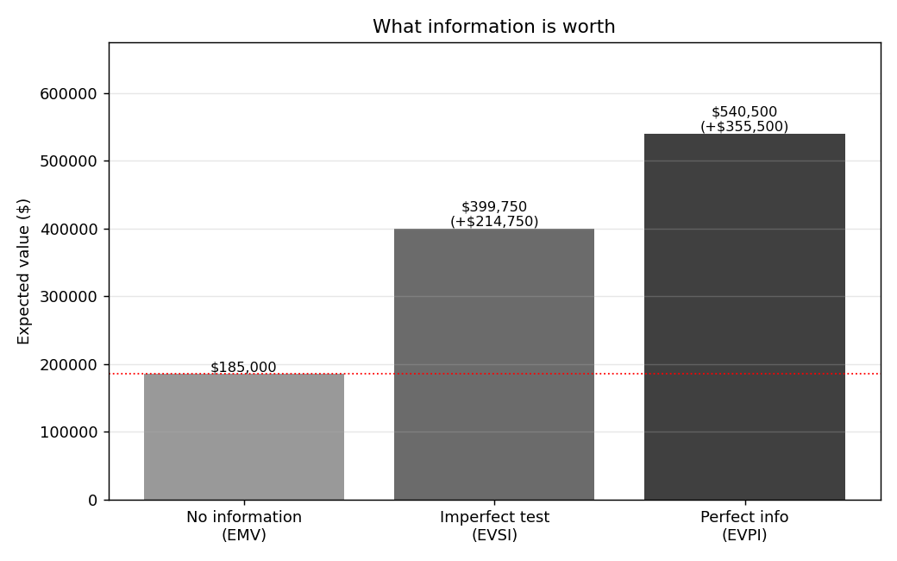

# Decision Analysis Engine

> **Course:** CivEnv 205 · **Week:** 10 · **Status:** ✅ Complete

## Problem
Maximising expected value is the textbook rule and it is wrong for most real
people: you would not bet tuition on a coin flip with slightly positive
expectation. Utility theory encodes risk aversion formally — which is what
explains insurance. Separately, information costs money, and EVPI/EVSI say what
it is rationally worth *before* you buy it.

## Approach
- Decision tree (decision / chance / terminal nodes) solved by backward
  induction, in utility space so decisions maximise certainty equivalent.
- Payoff-table interface for value-of-information questions, expandable to an
  explicit tree — both must agree, which the tests check.
- EVPI, and EVSI for an imperfect test via Bayes' Rule (reusing IEMS 302).
- Exponential utility `U(x) = 1 − e^(−x/R)`, certainty equivalents, risk premium.
- Insurance pricing from the indifference equation.

## Results


Wildcat drilling lease (EMV $185,000, accepting a 45% chance of −$700,000):

- **EVPI = $355,500** — a hard ceiling on what any study could be worth.
- **EVSI = $214,750** for a real seismic survey; **efficiency 60.4%**.
- **Risk aversion flips the decision** at R ≈ $2M: same dollars, opposite choice.
- **Insurance:** fair premium $4,000; a buyer with R = $100,000 would pay
  **$12,025**. That gap is why the market exists — and both sides gain.

## How to run
```bash
python projects/10-decision-analysis/decision_analysis.py       # 4 worked examples
python projects/10-decision-analysis/test_decision_analysis.py  # 67 checks
```

## What I learned
Value of information comes down to swapping two operators: EMV is
`max Σ p·V`, perfect information is `Σ p·max V`. That swap is the entire idea,
and it explains immediately why information can never have negative value and
why a test that never changes your decision is worth nothing regardless of its
accuracy. The utility half reframed something I'd assumed was a consumer
mistake: paying more than the fair premium for insurance is not irrational, it
is what risk aversion means, and the trade makes both parties better off.
