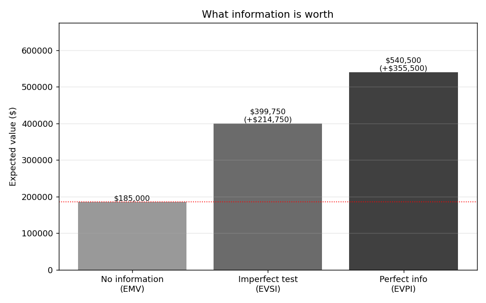
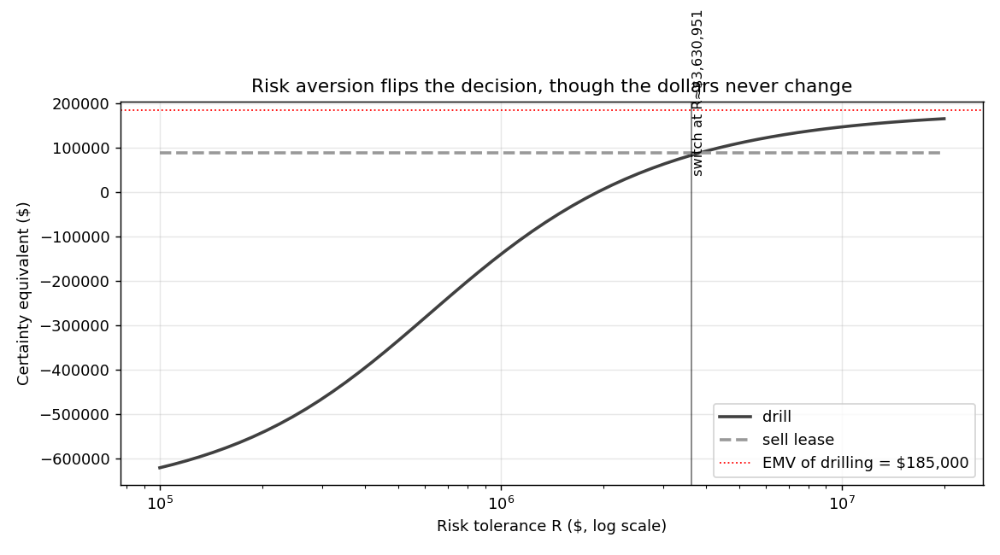
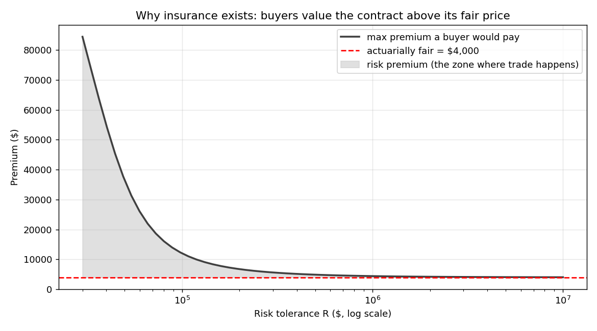

# Week 10 Summary — Decision Trees, Value of Information & Utility
**Course:** CivEnv 205 (reusing Bayes' Rule from IEMS 302) · **Author:** Tteddy

> All numbers are real output from `decision_analysis.py`.

## Question
Week 9 asked "is this project worth doing?" and assumed you decide now, with the
information you have, and that maximising expected dollars is the right rule.
All three assumptions are wrong in practice. This week relaxes them: decision
trees handle sequences of choices, value-of-information prices the research you
could do first, and utility replaces expected value with something that accounts
for the fact that people are not indifferent to ruin.

## Part 1 — Backward induction

A tree has three node types: **decision** nodes where you choose, **chance**
nodes where nature does, and **terminal** payoffs. Rolling back is one rule per
type — take the maximum at decisions, the expectation at chance nodes, and stop
at terminals — applied from the leaves inward.

The worked problem is a wildcat drilling lease:

| | dry (45%) | wet (30%) | soaking (25%) | Expected |
|:--|--:|--:|--:|--:|
| drill | −$700,000 | $500,000 | $1,400,000 | **$185,000** |
| sell lease | $90,000 | $90,000 | $90,000 | $90,000 |

Rollback picks **drill** at $185,000. Note this is a genuinely uncomfortable
recommendation: it accepts a 45% chance of losing $700,000. Expected value does
not care, which is exactly the limitation Part 3 addresses.

## Part 2 — What information is worth



### EVPI — the ceiling
With perfect information you learn the state *before* choosing, so you sell the
lease when it's dry and drill otherwise:

```
EVwPI = .45($90,000) + .30($500,000) + .25($1,400,000) = $540,500
EVPI  = $540,500 - $185,000 = $355,500
```

The whole content of value-of-information sits in the order of two operators.
EMV is `max_a Σ_s p(s)·V(a,s)`; with perfect information it becomes
`Σ_s p(s)·max_a V(a,s)`. Swapping the max and the sum is what information buys,
and by Jensen's inequality the difference can never be negative — you can always
ignore a report. **EVPI is a hard ceiling: no study, however good, is worth more
than $355,500.**

### EVSI — what a real test is worth
Perfect information does not exist. A seismic survey reads "closed" or "open"
structure with known reliability:

| | P(closed \| state) | P(open \| state) |
|:--|--:|--:|
| dry | 0.20 | 0.80 |
| wet | 0.70 | 0.30 |
| soaking | 0.90 | 0.10 |

Bayes' Rule turns a reading into revised beliefs. For "closed":

```
P(closed) = .45(.20) + .30(.70) + .25(.90) = 0.525
P(dry|closed)     = .09/.525  = 0.171   (down from 0.45)
P(soaking|closed) = .225/.525 = 0.429   (up from 0.25)
```

| Reading | p | Posterior (dry, wet, soaking) | Best action | Value |
|:--|--:|:--|:--|--:|
| closed | 0.525 | 0.171, 0.400, 0.429 | drill | $680,000 |
| open | 0.475 | 0.758, 0.189, 0.053 | sell lease | $90,000 |

```
EVSI = $214,750        Efficiency = EVSI/EVPI = 60.4%
```

**The survey is worth up to $214,750** — a real number to negotiate against,
derived before spending anything. The test earns its value by changing the
decision: after an "open" reading you sell, which you would not have done
otherwise. A test that never changes what you do is worth exactly zero no matter
how accurate it is, which the test suite verifies directly with an uninformative
likelihood.

## Part 3 — Utility: why expected value is the wrong rule

Maximising EMV says you should take any positive-expectation bet at any scale.
Nobody does, and they are not being irrational. Exponential utility
`U(x) = 1 − e^(−x/R)` encodes this: **R is risk tolerance in dollars**, and
smaller R means more averse.



The same drilling problem, seen by agents with different R:

| Risk tolerance R | CE drill | CE sell | Choice |
|:--|--:|--:|:--|
| infinite (risk neutral) | $185,000 | $90,000 | drill |
| $5,000,000 | $111,124 | $90,000 | drill |
| **$2,000,000** | **$7,279** | $90,000 | **sell lease** |
| $1,000,000 | −$139,586 | $90,000 | sell lease |
| $250,000 | −$501,772 | $90,000 | sell lease |

**The dollars never change. The decision does.** A wildcatter with $5M of risk
tolerance drills; one with $2M sells the same lease. The certainty equivalent of
drilling falls from $185,000 to −$501,772 as tolerance shrinks, while the certain
$90,000 is unmoved — a certain payoff is its own certainty equivalent at every R,
which the tests assert.

The gap between expected value and certainty equivalent is the **risk premium**:
$324,586 at R = $1M. That is what the agent would pay to be rid of the gamble.

## Part 4 — Insurance, priced from first principles



A household with $250,000 of wealth faces a 2% chance of a $200,000 loss. The
actuarially fair premium is the expected loss, **$4,000**. The most a buyer would
pay solves `U(wealth − premium) = E[U(wealth − loss)]`, which reduces to
`premium = wealth − CE(uninsured wealth)`:

| Risk tolerance R | Max premium | Markup over fair |
|:--|--:|--:|
| infinite | $4,000.00 | $0.00 |
| $1,000,000 | $4,418.28 | $418.28 |
| $200,000 | $6,757.67 | $2,757.67 |
| $100,000 | $12,025.21 | $8,025.21 |
| $50,000 | $36,424.82 | $32,424.82 |

**This is why insurance markets exist.** The risk-neutral agent pays exactly the
fair premium and not a cent more, so no trade is possible with a
break-even insurer. Every risk-averse buyer values the contract *above* its fair
price. The insurer, holding thousands of independent policies, is effectively
risk neutral by the law of large numbers and values it *at* the fair price. The
shaded region on the chart is the resulting bargaining zone — and both sides
genuinely gain, which is the part that surprises people. Insurance is not a bet
the customer loses on average; it is a trade between parties who value the same
risk differently.

## Part 5 — A real decision: take the early offer or wait?

| | top offer (30%) | comparable (40%) | nothing (30%) | Expected |
|:--|--:|--:|--:|--:|
| accept early offer | $12,000 | $12,000 | $12,000 | $12,000 |
| decline and interview | $30,000 | $13,000 | $0 | **$14,200** |

Expected value says **decline** — waiting is worth $2,200 more. But:

| R | CE accept | CE decline | Choice |
|:--|--:|--:|:--|
| risk neutral | $12,000 | $14,200 | decline |
| $50,000 | $12,000 | $12,870 | decline |
| **$25,000** | $12,000 | **$11,624** | **accept** |
| $10,000 | $12,000 | $8,581 | accept |

The switch happens somewhere around R ≈ $30,000. A student whose entire summer
income is at stake has a risk tolerance in exactly that range — so accepting the
"suboptimal" early offer is the correct decision *for them*, not a failure of
nerve. EVPI here is $3,600: that is the most it would be worth to know the other
interviews' outcomes in advance, which puts a ceiling on how much effort chasing
early signals deserves.

## Testing
`test_decision_analysis.py` runs **67 checks**. Decision analysis is unusually
easy to get subtly wrong — swap a max and a sum and EVPI comes out plausible but
incorrect; apply utility after averaging instead of before and risk aversion
silently vanishes — so the suite leans on two things a bug cannot fake.

**Hand-computed values:** the Bayes posteriors (.09/.525 and so on), EVwPI from
the payoff table, the utility formula at a known point.

**Structural theorems that must hold for any problem:**
- EVPI ≥ 0 always, and exactly 0 when one action dominates in every state.
- EVSI ≤ EVPI always.
- A **perfect** test is worth **exactly** EVPI (verified to $355,500).
- An **uninformative** test is worth **exactly zero**, and its posterior equals
  the prior.
- A certain payoff is its own certainty equivalent at every R.
- The insurance premium satisfies the indifference equation it was derived from.
- The explicit tree and the payoff table agree on both value and chosen action,
  at every risk tolerance.

All 67 pass.

## So what?
This closes Phase 3 and supplies the last piece the capstone needs. Week 11's
optimizer will trace an efficient frontier — a set of portfolios, not a
recommendation — and the certainty-equivalent machinery here is what turns that
set into a single answer for a particular investor. The Bayes code is the same
machinery as Week 4's Beta-Binomial updater, now used to price information
rather than to track a belief.
