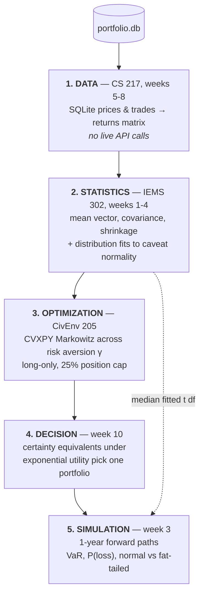
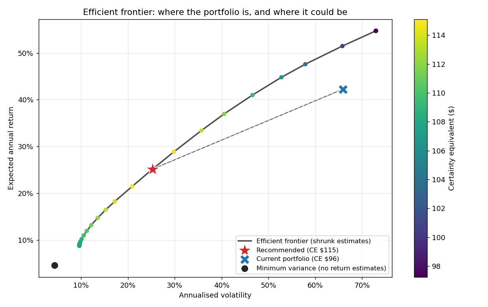

# Capstone: Utility-Based Portfolio Optimizer

> **Course:** All three · **Weeks:** 11-12 · **Status:** ✅ Complete

## Problem
Most retail allocation is done by feel — a bit of this, a bit of that — with no
measure of the risk-return trade-off actually accepted, and no way to tell
whether a different mix dominates it on both dimensions. This answers three
concrete questions about real money: what is the best achievable return for the
risk being taken, which allocation matches *my* risk tolerance rather than a
generic one, and what is the honest probability of losing more than 10% next
year.

## Architecture



## Approach
- **Reads from the database, never from a live API.** The data layer built in
  weeks 5–8 is the single source of truth.
- **Shrinkage before optimization.** Jorion Bayes-Stein for the mean vector,
  Ledoit-Wolf for the covariance, both implemented from the papers. Without them
  the optimizer is an error maximizer.
- **A minimum-variance benchmark** that uses no return estimates at all — what a
  return forecast has to beat to justify itself.
- **A risk-tolerance sweep** rather than one confident recommendation, because
  nobody knows their own risk tolerance to two significant figures.
- **Tail risk at two depths and four horizons**, because a 5% VaR is not deep
  enough for fat tails to show up.

## Results



| | Current | Recommended |
|:--|--:|--:|
| Expected return | 42.3% | 25.2% |
| Volatility | 65.9% | **25.3%** |
| Sharpe ratio | 0.64 | **1.00** |
| P(loss > 10%) | 32.0% | **9.8%** |
| 1% VaR | 73.7% | **30.8%** |
| Holdings | 9 | 7 |

The recommendation gives up 17 points of expected return to cut volatility by
62% and make a double-digit loss roughly a third as likely. It adds gold and a
broad dividend fund — neither held before, neither there for its expected
return. Both earn their place through low correlation.

## How to run
```bash
python projects/11-capstone-platform/capstone.py              # full pipeline + charts
python projects/11-capstone-platform/capstone.py --risk 5000  # a different risk tolerance
python projects/11-capstone-platform/export_results.py        # JSON for the site
python projects/11-capstone-platform/test_capstone.py         # 78 checks
python site/build_page.py                                     # self-contained results page
```

By default the utility scale is anchored to the portfolio's real market value.
The committed charts were generated with `--wealth 100`, which indexes every
dollar figure to a base of 100 — the recommendation is identical either way,
since risk tolerance scales with wealth, but the published output carries no
account values:

```bash
python projects/11-capstone-platform/capstone.py --wealth 100
```

## Files
- `capstone.py` — the five-layer pipeline
- `robust.py` — Ledoit-Wolf and Bayes-Stein shrinkage, minimum-variance portfolio
- `charts.py` — frontier, allocation, fan chart, risk sweep
- `export_results.py` — precomputes the site JSON (values indexed to 100 by default)
- `test_capstone.py` — 78 checks, including estimators scored against a known covariance
- `WEEK11_SUMMARY.md` — the full writeup

## What I learned
The constraint is never the solver — CVXPY solved everything in milliseconds.
The binding constraint is the quality of the inputs and the willingness to admit
they are estimates. The first run recommended 100% into four stocks at a
projected 124% annual return, because Markowitz cannot distinguish a genuinely
high expected return from a lucky one. And the fat tails I spent Phase 1
measuring turned out to barely affect one-year risk: the Central Limit Theorem
washes them out under summation, which means the real long-horizon danger is
dependence, not tail shape — something this model does not capture and therefore
understates.
